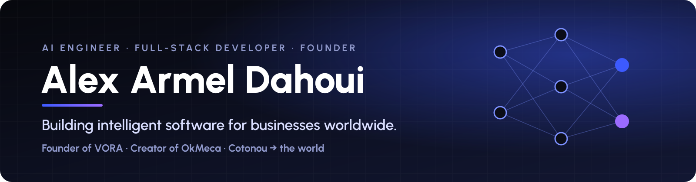

## ⚡ About Me

I'm an **Artificial Intelligence graduate** from IFRI – University of Abomey-Calavi (Benin), applying for a
**research master's in AI (fall 2027)**. My bachelor's thesis, graded **Très bien (highest honours)**, uses deep
learning to segment brain CT scans for the early detection of **ischemic stroke**.

I work at the crossroads of **AI research** and **production software**: I train and evaluate models, and I also
ship them inside real products used by real people, from a DICOM viewer for clinicians to apps on the App Store.

- 🔬 **Research interests** — medical image analysis, deep-learning segmentation, neuro-imaging and stroke
  imaging, learning with few annotations, model robustness and uncertainty, AI for health in low-resource settings.
- 🧠 **AI experience** — deep learning and data engineering internship at TARGECH (France, remote), AI / back-end
  developer at NOVEK AI, AI track internship at the IT department of Benin's Ministry of Foreign Affairs.
- 🚀 **Founder of [VORA](https://github.com/Vora-bj)** — a software company building SaaS platforms, mobile apps and
  AI products; currently building **OkMeca**.

## 🔬 Research

### Automatic segmentation of brain CT scans for early detection of ischemic stroke
Bachelor's thesis · 2026 · Grade: <b>Très bien</b> · Supervisors: Dr Arnaud Ahouandjinou (CAMES Associate Professor) and Dr Wahabou Taba Chabi

| Step | What I did | Result |
|---|---|---|
| **Data** | 194 annotated non-contrast brain CT scans (CNHU-HKM, Cotonou), 342 images after augmentation | Test set of 138 cases (80 healthy, 58 stroke) |
| **Segmentation** | U-Net segmenting the cerebral vascular territories (ACA, MCA, PCA) | **Dice 0.96 · IoU 0.93** |
| **Radiomics** | 19 texture features (GLCM, GLRLM) measuring inter-hemispheric asymmetry | Interpretable asymmetry markers |
| **Classification** | SVM + XGBoost + AdaBoost ensemble detecting sulcal effacement | **AUC 0.843** · accuracy 76.8 % |
| **Deployment** | Web app (Django REST, React) reading DICOM images, showing segmentation and effacement score | Usable by clinicians |

Python · TensorFlow/Keras · scikit-learn · scikit-image · OpenCV · Roboflow · Google Colab (GPU)

## 🧠 AI Projects

| Project | Field | Highlights |
|---|---|---|
| **[AI4CKD](https://github.com/Dossou2003/AI4CKD)** | Clinical ML | Predicts the stage of chronic kidney disease from clinical data, risk-factor analysis — **87 % accuracy** (XGBoost, scikit-learn) |
| **Land-law AI assistant** | NLP · multimodal | Text, audio and image chatbot on Benin's land laws, built in 48 h at the ASIN AI Hackathon 2025 (Whisper, Transformers, FAISS) |
| **UniSafe+** 🏆 | Emotion AI | Campus safety platform detecting distress with AI — **winner, AUF Hackathon 2024** (TensorFlow, React Native) |
| **RAG assistant** | LLM · RAG | Semantic search and grounded answers over an organisation's documents — **50 % less time** searching (LangChain, FAISS) |
| **[Pet image classification](https://github.com/Dossou2003/Pet-Image-Classification-Project)** | Computer vision | CNN image classifier with pretrained architectures (PyTorch) |

## 🏆 Awards

- 🥇 **Winner — AUF Hackathon (UniSafe+)**, Agence universitaire de la Francophonie, 2024
- 🥇 **Winner — Blockchain Innovators Challenge (EpargnChain)**, Africa Blockchain Institute, Tether, TON Foundation, 2024
- 🏅 **AI Hackathon "Le foncier intelligent"**, ASIN, ANDF & LuxDev, 2025

## 🚀 What I'm Building

**OkMeca**, by VORA, is the all-in-one platform for car repair shops: quotes, live repair tracking, invoicing, stock
and payments, on mobile and web. Launching in 2026.

## 🛠️ Tech Stack

### 🧠 AI, Vision & Data

  
  
  
  
  
  
  
  
  
  
  

### 🌐 Software Engineering

  
  
  
  
  
  
  
  
  

## 📊 GitHub Activity

Generated every day by a GitHub Action, private repositories included.

  
  

  

  

## 🎖️ GitHub Trophies

  

<picture>
  <source media="(prefers-color-scheme: dark)" srcset="https://raw.githubusercontent.com/Alex200329/Alex200329/sortie/dossou-snake-dark.svg"/>
  
</picture>

 
Made with ❤️ in Cotonou

